# Real Estate CRM on HubSpot

A demo CRM for a real estate sales team, built in HubSpot with sample data. It covers the full path from a new lead to a closed deal: lead capture, qualification, a property-specific pipeline, automated owner assignment, data-quality checks and a management dashboard.

> **Note:** all names, emails, phone numbers and amounts are fictional sample data. This is a learning project, not a production system.

## What it covers

| Area | What I built |
|---|---|
| **Lead management** | 15 sample leads from 5 sources (Website, Facebook, Referral, Walk-in, Portal), with a Qualification Status (New, Contacted, Qualified, Unqualified, Unresponsive) |
| **Sales pipeline** | Qualification, Property Matching, Viewing Scheduled, Viewing Completed, Offer / Negotiation, Closed. Stage probabilities (10% to 80%) feed a weighted forecast |
| **Automation** | Owner assignment by region and by property type, in-app notification, delay, follow-up task. Extra workflows for new deals and new owners |
| **Data model** | Custom property group with Budget Maximum, Lead Source, Disqualification Reason, Next Follow-up Date and Preferred Location |
| **Data quality** | Kanban view with cards for missing owner, email and lead source; property fill rates to find fields that need enforcement |
| **Reporting** | Dashboard with qualification report, contact sources, deals by stage and owner, deal budgets by country and team activity |
| **Currency** | Deals can be entered in local currency (e.g. EGP) and are reported in the company currency (SAR) |

## Screenshots

| | |
|---|---|
| 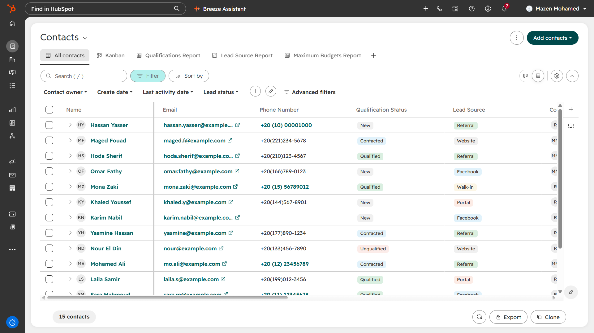 **Contacts** | 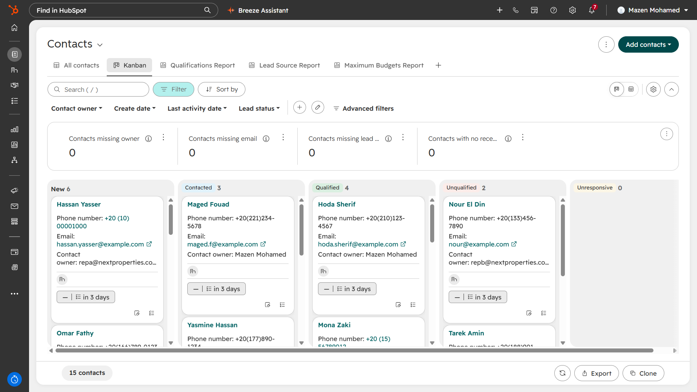 **Kanban + data-quality cards** |
| 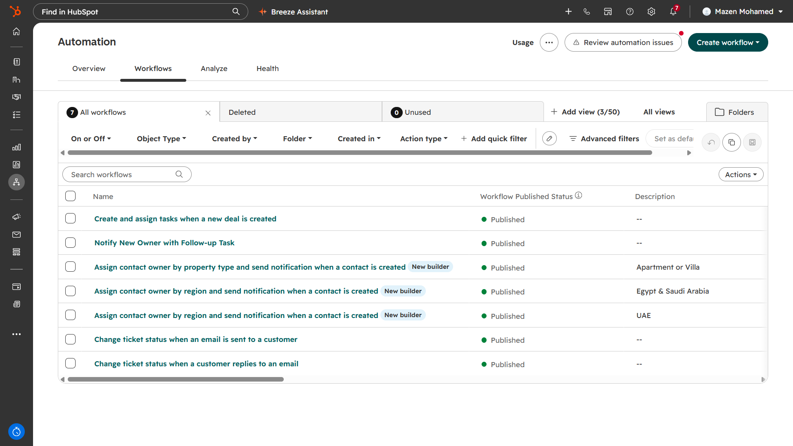 **Workflows** | 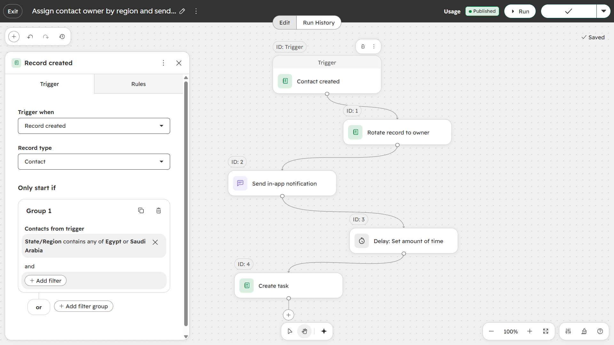 **Owner assignment by region** |
| 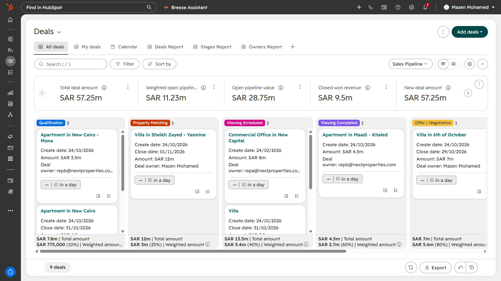 **Deals pipeline** | 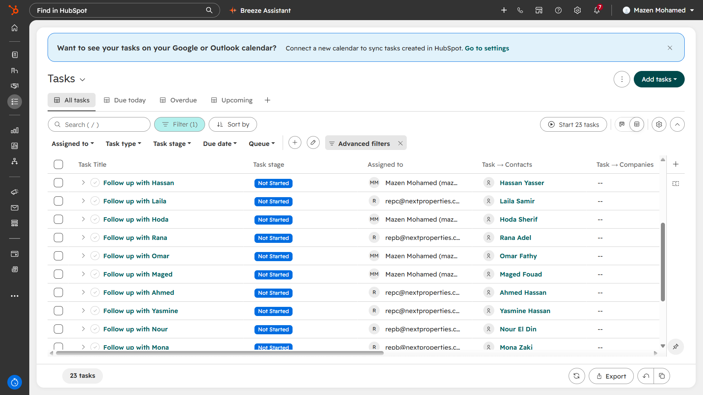 **Follow-up tasks** |
| 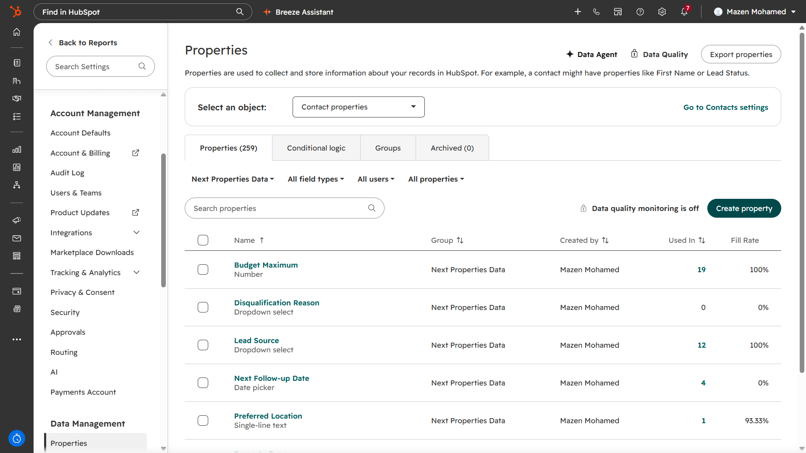 **Custom properties** | 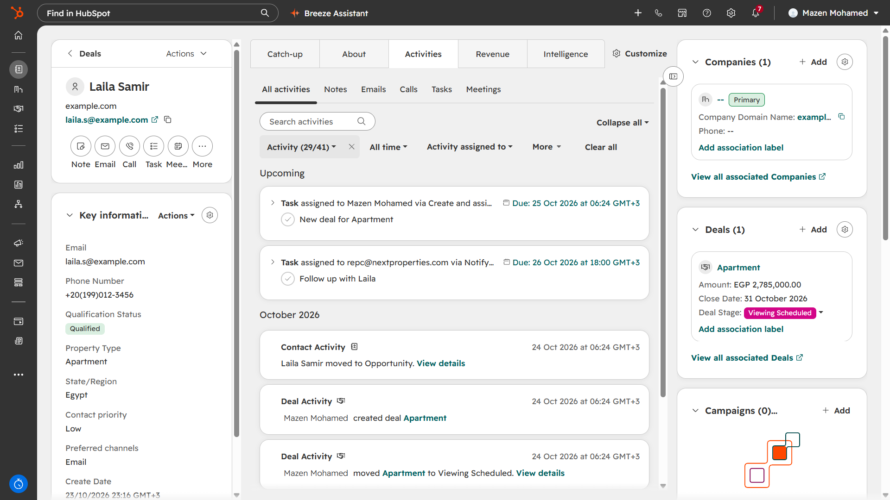 **Contact record with associated deal** |
| 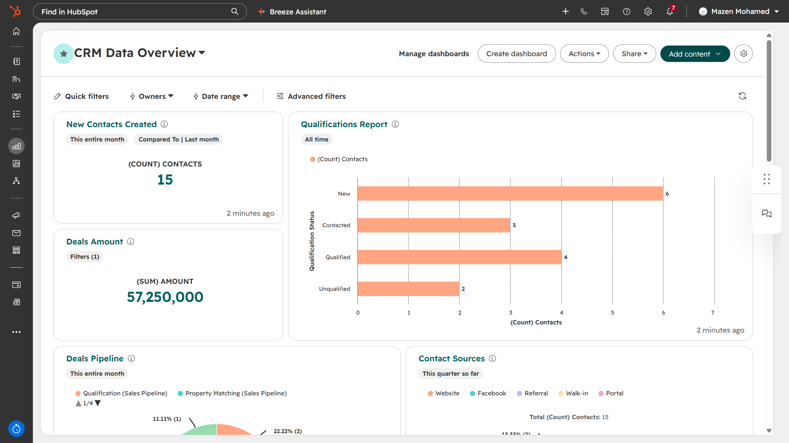 **Dashboard overview** | 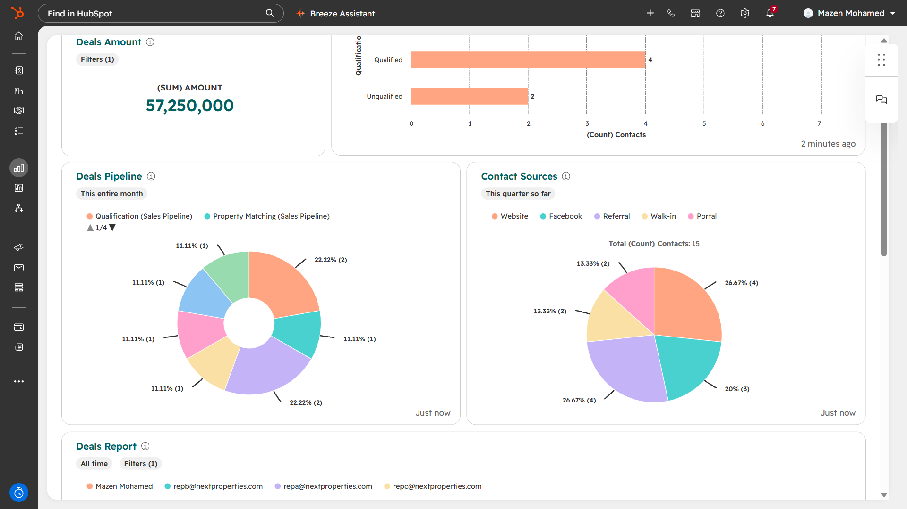 **Pipeline and sources** |
| 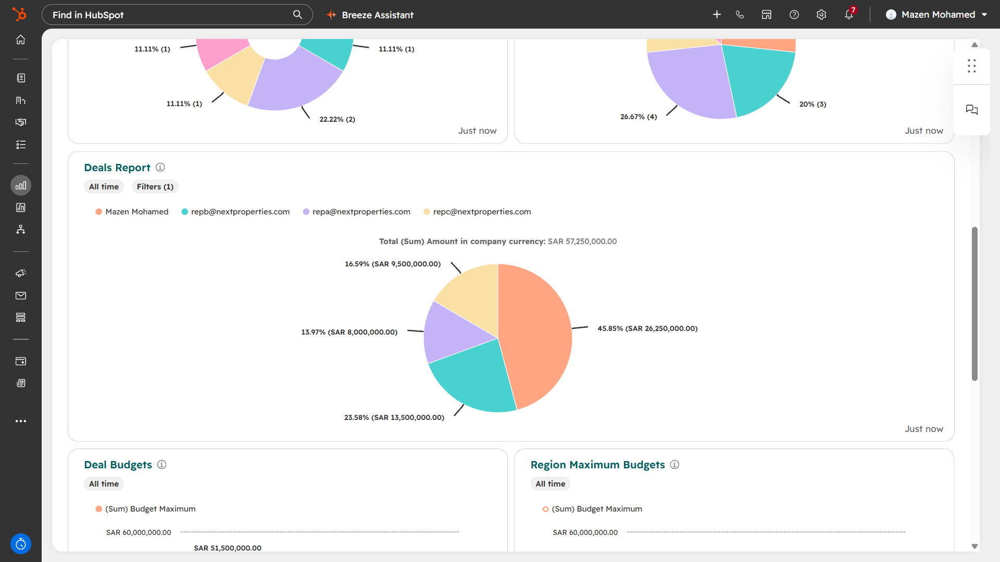 **Deals by owner** | 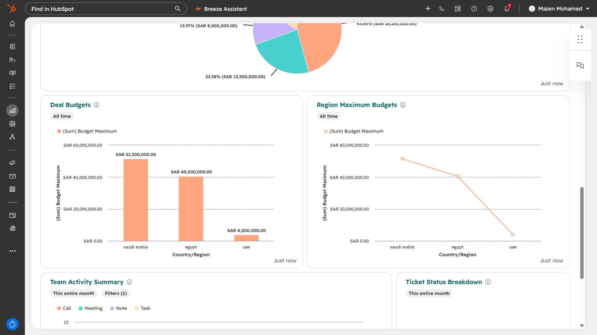 **Budgets by country** |

## Design decisions

- **Speed to lead:** every new contact is assigned an owner and gets a follow-up task automatically, so no lead waits for manual assignment.
- **Real estate stages:** viewing stages sit between qualification and negotiation, because that is how property sales actually progress.
- **Governance first:** dropdown properties for Lead Source and Disqualification Reason instead of free text, plus views that surface missing data.

## Known gaps and next steps

- Rebuild the same design in **Zoho CRM** (Lead to Contact to Deal, Blueprint, Workflow Rules) and compare the two platforms.
- Make Disqualification Reason required when a contact is marked Unqualified.
- Turn Preferred Location into a dropdown.
- Add a speed-to-lead KPI (time to first contact per owner and source).
- Duplicate management and data-quality monitoring (paid HubSpot feature).
- WhatsApp lead capture through an automation platform.

## Presentation

Slides: [PDF](docs/HubSpot-Real-Estate-CRM.pdf) | [PowerPoint](docs/HubSpot-Real-Estate-CRM.pptx)

## Author

**Mazen Mohamed**, Operations & CRM Specialist
[LinkedIn](https://linkedin.com/in/mazen-mohamed-5b0716247) | [GitHub](https://github.com/mazenmuhamed)
